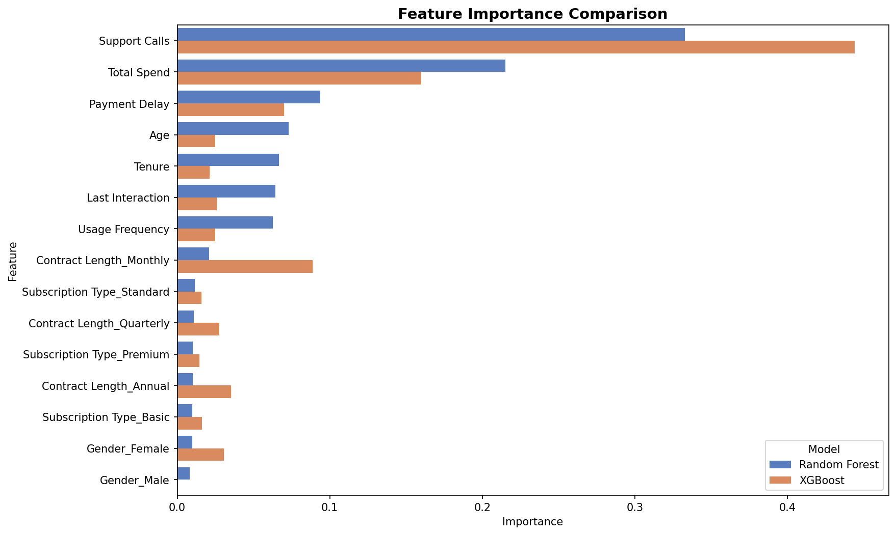
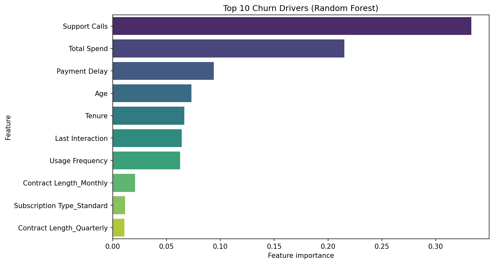
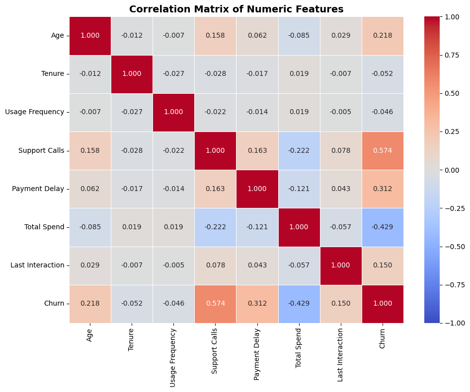

# Customer Churn Prediction

An end-to-end, reproducible machine-learning pipeline that predicts which subscription customers are likely to churn. It downloads the data from Kaggle, cleans it, builds a leak-free scikit-learn preprocessing pipeline, compares four classifiers, saves the best one, and serves predictions from the command line.


## Highlights

- **Single `Pipeline` per model**: imputation, scaling and one-hot encoding are fitted on training data only.
- **Four models compared**: Logistic Regression (baseline), Random Forest, Gradient Boosting, XGBoost.
- **Model selection on a validation split**, never on the test file.
- **CLI entry points** for download, EDA, training and batch prediction.
- **Unit and end-to-end tests** plus GitHub Actions CI.

## Dataset

[Customer Churn Dataset](https://www.kaggle.com/datasets/muhammadshahidazeem/customer-churn-dataset) (Kaggle): 440,832 training rows and 64,374 test rows, 10 features and a binary `Churn` target (56.7% churn in the training file). See [`data/README.md`](data/README.md).

## Results

Original experiment: models fitted on the full training file and scored on the official test file.

| Model | ROC-AUC | Accuracy | Churn recall | Churn precision |
|---|---|---|---|---|
| Logistic Regression | 0.689 | 0.57 | 0.99 | 0.53 |
| Random Forest | 0.606 | 0.50 | 1.00 | 0.49 |
| **Gradient Boosting** | **0.723** | 0.51 | 1.00 | 0.49 |
| XGBoost | 0.670 | 0.50 | 1.00 | 0.49 |

**Read these numbers with care.** Accuracy near 50% with churn recall near 100% means the models predict "churn" for almost every test customer. A likely cause is a distribution mismatch between the two files: in the training file *every* Monthly-contract customer churned (87,104 of 87,104), a pattern that does not appear to carry over to the test file. Because of this, `churn-train` also reports metrics on a stratified validation split of the training file, and picks the best model from that split. Compare both sets of numbers (`reports/metrics.json`) before drawing business conclusions.

### Synthetic demo results

The offline smoke-test dataset contains 5,000 training rows and 1,000 test rows.
It is generated with `scripts/generate_sample_data.py` and is intended only to verify
that the pipeline runs; these metrics are not evidence of real-world model performance.

| Model | Validation ROC-AUC | Validation accuracy | Test ROC-AUC | Test accuracy |
|---|---:|---:|---:|---:|
| **Logistic Regression** | **0.9366** | 0.8440 | **0.9406** | 0.8670 |
| Random Forest | 0.9005 | 0.8320 | 0.9118 | 0.8340 |
| Gradient Boosting | 0.9167 | 0.8380 | 0.9142 | 0.8330 |
| XGBoost | 0.9208 | 0.8270 | 0.9286 | 0.8420 |

The pipeline selected Logistic Regression by validation ROC-AUC. After refitting on
the full synthetic training set, the saved model achieved a test ROC-AUC of 0.9405,
accuracy of 0.8570, precision of 0.8679, recall of 0.8757, and F1 score of 0.8717.
The complete metrics are stored in [`reports/metrics.json`](reports/metrics.json).

### Key drivers (Random Forest vs XGBoost)

Support calls, total spend, age, payment delay and a monthly contract rank highest. Correlation with churn: support calls +0.57, payment delay +0.31, age +0.22, total spend -0.43.



| Top drivers | Correlation matrix |
|---|---|
|  |  |

The figures above come from the original notebook run; `churn-train` and `churn-eda` regenerate them (plus ROC curves) in `reports/figures/`.

## Project structure

```
customer-churn-prediction/
├── .github/workflows/ci.yml     # runs pytest on Python 3.10-3.12
├── data/
│   ├── raw/                     # CSVs go here (git-ignored)
│   ├── processed/
│   └── README.md                # data dictionary + download instructions
├── models/                      # saved model (git-ignored)
├── reports/
│   ├── figures/                 # plots
│   └── metrics.json             # written by churn-train
├── scripts/
│   └── generate_sample_data.py  # synthetic data for offline demos
├── src/churn/
│   ├── config.py                # paths and constants
│   ├── data.py                  # Kaggle download, loading, cleaning
│   ├── features.py              # column inference + preprocessing
│   ├── models.py                # candidate models + pipeline builder
│   ├── evaluate.py              # metrics and plots
│   ├── eda.py                   # correlation + churn-by-contract figures
│   ├── train.py                 # training / comparison / model selection
│   ├── predict.py               # batch inference
│   └── synthetic.py             # synthetic data generator (tests)
├── tests/test_pipeline.py
├── pyproject.toml
├── requirements.txt
├── LICENSE
└── README.md
```

## Quickstart

**Windows (PowerShell)**

```powershell
python -m venv .venv
.venv\Scripts\Activate.ps1
pip install -e ".[dev]"
```

**macOS / Linux**

```bash
python -m venv .venv
source .venv/bin/activate
pip install -e ".[dev]"
```

### 1. Get the data

Create a Kaggle API token (Kaggle > Settings > API > Create New Token), save `kaggle.json` to `~/.kaggle/` (Windows: `C:\Users\<you>\.kaggle\`), then:

```bash
churn-download
```

Or download the two CSVs manually into `data/raw/`.

### 2. Explore, train, predict

```bash
churn-eda                                   # EDA figures
churn-train                                 # compare models, save the best one
churn-predict --input new_customers.csv --output predictions.csv
```

`new_customers.csv` needs the same columns as the training data (`Churn` is optional). Output adds `churn_probability` and `churn_prediction`.

### No Kaggle account? Try the pipeline on synthetic data

```bash
python scripts/generate_sample_data.py --out data/sample
churn-train --data-dir data/sample --fast
```

Synthetic data only checks that the code runs; its metrics mean nothing.

## Tests

```bash
pytest -q
```

## Methodology notes

1. **Cleaning**: drop empty and unlabeled rows, cast `Churn` to int.
2. **Features**: `CustomerID` is excluded; numeric columns are median-imputed and standardised; categorical columns are mode-imputed and one-hot encoded (unknown categories ignored at inference).
3. **Selection**: 80/20 stratified split of the training file; best model by validation ROC-AUC, then refit on the full training file.
4. **Threshold**: predictions use 0.5; tune with `--threshold` to trade precision against recall.

## Ideas for improvement

- Investigate the train/test distribution shift before further tuning.
- Hyper-parameter search with cross-validation (Optuna / `RandomizedSearchCV`).
- Probability calibration and cost-based threshold selection.
- SHAP explanations; a small FastAPI or Streamlit app for serving.

## License

MIT, see [`LICENSE`](LICENSE).
